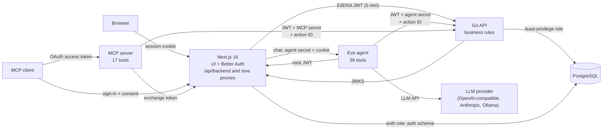

# OpenStock AI

A self-hosted inventory app for a single owner, with an AI assistant that reads and changes data only through explicit tools that call the Go API. Writes that matter wait for the owner's approval.

Next.js owns the UI and identity, Go owns every business rule, PostgreSQL is the source of truth, and an [Eve](https://www.npmjs.com/package/eve) agent exposes 39 typed tools to the model. An MCP server (protocol revision 2026-07-28) offers the same operations and the same approval flow to external clients such as Claude Code.

## Design points

- **Tools only.** The model has no SQL, no database connection and no shell. Each tool wraps a Go REST endpoint.
- **Go decides.** Validation, the approval policy, idempotency and audit live in Go. Nothing depends on the model obeying the prompt.
- **Two-phase writes.** A write is registered as an `agent_action`, approved if the policy requires it, and then executed with exactly the payload that was registered. Deletes, archives, restores and quantities above 1000 always need approval.
- **Immutable ledger.** Stock movements and audit logs reject `UPDATE` and `DELETE` in the database. Every mutation is one transaction and is idempotent.
- **Bounded and observable.** Per-call token, step and time limits; an Agent runs page with steps, tool calls, approvals, tokens and an estimated cost.
- **Provider-agnostic.** Any OpenAI-compatible endpoint, native Anthropic, or a local Ollama model.
- **Evaluated.** 17 end-to-end evals run a real model against a throwaway stack.
- **MCP for external clients.** OAuth 2.1 with Client ID Metadata Documents (no dynamic registration), stateless HTTP, and approvals over Multi Round-Trip Requests: small writes are confirmed in the client, archives, restores and large quantities by the owner in OpenStock.

The product covers inventory with per-warehouse stock, catalogs, purchases, adjustments, transfers and physical counts, a restock view, an audit log, CSV export, a dashboard and analytics.

## Architecture



- The browser only talks to Next.js. Next validates the Better Auth session, mints a five-minute EdDSA JWT and forwards allow-listed routes to Go. Go verifies it against Next's JWKS and checks that the session is still active.
- The agent never holds a user token. It mints one per tool call through an internal route guarded by `AGENT_SERVICE_SECRET`. Go treats a request as an AI actor only when that secret is present.
- Go is the only service that reads or writes business data. Next only touches the `auth` schema.
- An MCP client signs in through Better Auth's OAuth provider and gets an access token for the MCP server only. The MCP server verifies it, exchanges it per call for a five-minute Go token with the actor `mcp` and the granted scopes, and never forwards the client's token.

Details, boundaries and the data model are in [docs/ARCHITECTURE.md](docs/ARCHITECTURE.md). The agent (tool selection, approval lifecycle, limits, evals) and the MCP surface are in [docs/AI.md](docs/AI.md).

## Tech stack

| Layer    | Technology                                                                                                          |
| -------- | ------------------------------------------------------------------------------------------------------------------- |
| Web      | Next.js 16.4.5, React 19.3, TypeScript 6, Tailwind CSS 4, Radix UI                                                  |
| Auth     | Better Auth 1.7.28 (email and password, JWT plugin with EdDSA/Ed25519, OAuth provider with MCP and CIMD plugins)    |
| API      | Go 1.27.3, chi 5.3, pgx 5.11, goose 3.28 (migrations), sqlc 1.31 (queries), golang-jwt 5.3                          |
| Database | PostgreSQL 18.6 with `pg_trgm`                                                                                      |
| Agent    | Eve 1.5.0, Vercel AI SDK 7 (`ai` 7.0.183), `@ai-sdk/openai` 4.0.125, `@ai-sdk/anthropic` 4.0.110, TOON 4.4, Zod 4.6 |
| MCP      | MCP TypeScript SDK 2.4 (`@modelcontextprotocol/server`, `@modelcontextprotocol/node`), protocol revision 2026-07-28 |
| Tooling  | pnpm 11.25 workspaces, Node 24, ESLint 9, Prettier 3.9, Docker Compose                                              |

## Quick start

Requirements: Docker with Compose. You also need an API key for an LLM provider, or a machine that can run Ollama.

```bash
cp .env.example .env
# edit .env: set LLM_PROVIDER, LLM_BASE_URL, LLM_API_KEY and LLM_MODEL
docker compose up -d --build
```

Open <http://localhost:3000> and create the owner account. Secrets and database credentials are generated for you on first start. There are no default credentials. Without a valid LLM key the app still works and the assistant reports that AI is not configured.

After editing `.env`, run `docker compose up -d` again (a plain `docker compose restart` does not re-read `.env`).

Other ways to run it:

```bash
# Start with fictional demo data (a small hardware store)
docker compose --profile demo up -d

# Use a local model instead of a hosted one
# (in .env: LLM_PROVIDER=ollama and a tool-capable model such as LLM_MODEL=qwen3:8b)
docker compose --profile ollama up -d

# Hot reload for development
docker compose -f compose.yaml -f compose.dev.yaml up --build

# Forgot the owner password (prompts for the new one and signs out every session)
docker compose run --rm reset-owner-password
# or non-interactively
printf '%s\n' "$NEW_PASSWORD" | docker compose run --rm -T reset-owner-password

# Delete everything, including the database volume
docker compose down -v

# Run the agent evals (needs a real LLM key; uses its own isolated stack)
pnpm agent:eval
```

### Connect an MCP client

The MCP server listens on <http://localhost:3100/mcp>. With Claude Code:

```bash
claude mcp add --transport http openstock http://localhost:3100/mcp
claude mcp login openstock     # sign in as the owner and allow the client
```

The consent page shows the client's self-declared name as unverified, next to its client ID host and redirect target. Connected clients are listed under Settings, where you can disconnect them. Claude Code fetches its client metadata document from the authorization server, so the web service needs outbound HTTPS for the first sign-in. To remove it: `claude mcp logout openstock && claude mcp remove openstock`.

## Configuration

Set these in `.env` (see `.env.example` for the full list and provider presets).

| Variable                                                | Purpose                                                 | Default                     |
| ------------------------------------------------------- | ------------------------------------------------------- | --------------------------- |
| `LLM_PROVIDER`                                          | `openai-compatible`, `anthropic` or `ollama`            | `openai-compatible`         |
| `LLM_BASE_URL`                                          | Provider endpoint (optional for Anthropic)              | OpenAI URL / Ollama service |
| `LLM_API_KEY`                                           | Provider key. Optional for Ollama and local endpoints.  | none                        |
| `LLM_MODEL`                                             | Model ID (required)                                     | none                        |
| `LLM_PRICE_INPUT_PER_MTOK`, `LLM_PRICE_OUTPUT_PER_MTOK` | USD per million tokens, used only for the cost estimate | unset (no estimate)         |
| `AI_MAX_INPUT_TOKENS`                                   | Input limit per model call                              | 65536                       |
| `AI_MAX_OUTPUT_TOKENS`                                  | Output limit per model call                             | 2048                        |
| `AI_MAX_STEPS_PER_TURN`                                 | Model steps per user message                            | 8                           |
| `AI_TOOL_SELECTION`                                     | `progressive` or `all`                                  | `progressive`               |
| `AI_TOOL_RESULT_FORMAT`                                 | `auto` (TOON when smaller) or `json`                    | `auto`                      |
| `WEB_PORT`                                              | Published web port                                      | 3000                        |
| `API_PORT`                                              | Published Go API port                                   | 8087                        |
| `POSTGRES_PORT`                                         | Published PostgreSQL port                               | 55432                       |
| `MCP_PORT`                                              | Published MCP server port                               | 3100                        |
| `MCP_RESOURCE_URL`                                      | Public MCP URL, the audience of every access token      | `http://localhost:3100/mcp` |

Internal secrets (`BETTER_AUTH_SECRET`, `AGENT_SERVICE_SECRET`, `MCP_SERVICE_SECRET`, `MCP_STATE_SECRET`, database passwords) are generated and never need to be set by hand.

## Local development without Docker

The hot-reload Compose override above is the easiest development setup. To run the processes on the host instead you need Node 24, pnpm, Go 1.27 and a PostgreSQL 18 server, plus the variables that `compose.yaml` passes to each service set in `.env`: `DATABASE_URL`, `API_DATABASE_URL`, `AUTH_DATABASE_URL`, `API_DATABASE_PASSWORD`, `AUTH_DATABASE_PASSWORD`, `BETTER_AUTH_SECRET`, `AGENT_SERVICE_SECRET` (at least 32 characters) and the service URLs (`BETTER_AUTH_URL`, `BETTER_AUTH_JWKS_URL`, `API_BASE_URL`, `EVE_BASE_URL`). The MCP server also needs `MCP_SERVICE_SECRET` (shared with Go and the web app) and `MCP_STATE_SECRET`, at least 32 characters each; without `MCP_SERVICE_SECRET` Go and the web app keep the MCP path disabled.

```bash
pnpm install
pnpm db:migrate         # apply goose migrations
pnpm db:provision       # create the least-privilege API and auth logins
pnpm api:dev            # Go API
pnpm agent:dev          # Eve agent on 127.0.0.1:4273
pnpm dev                # Next.js on 127.0.0.1:3017
pnpm mcp:dev            # MCP server on 127.0.0.1:3100 (optional)
```

Useful scripts from the root `package.json`:

| Script                             | What it does                                             |
| ---------------------------------- | -------------------------------------------------------- |
| `pnpm build`, `pnpm start`         | Build and serve the web app                              |
| `pnpm agent:build`                 | Build the Eve agent                                      |
| `pnpm mcp:dev`                     | MCP server with reload on 127.0.0.1:3100                 |
| `pnpm db:generate`                 | Regenerate sqlc Go code from `apps/api/db`               |
| `pnpm api:generate`                | Regenerate the TypeScript API client from `openapi.json` |
| `pnpm auth:schema`                 | Regenerate the Better Auth schema                        |
| `pnpm owner:reset-password`        | Reset the owner password from the terminal               |
| `pnpm format`, `pnpm format:check` | Prettier on the TypeScript sources                       |

## Testing

There is no CI and no browser (E2E) suite in this repository. Everything runs locally:

| Command                                                        | Covers                                                                                    |
| -------------------------------------------------------------- | ----------------------------------------------------------------------------------------- |
| `pnpm typecheck`                                               | TypeScript across all workspaces                                                          |
| `pnpm lint`                                                    | ESLint                                                                                    |
| `pnpm test:architecture`                                       | Module boundaries for Next, packages and Go                                               |
| `pnpm test:go`                                                 | Go unit tests (the PostgreSQL ones are skipped)                                           |
| `pnpm test:integration`                                        | Go tests including PostgreSQL, in a disposable database created and dropped by the script |
| `pnpm test:auth`                                               | Better Auth single-owner flow, in a disposable database                                   |
| `pnpm test:agent`                                              | Agent tools, tool selection, approval flow, TOON output and trace parsing                 |
| `pnpm test:mcp`                                                | MCP transport, OAuth challenges, tools, resources, skills and the MRTR approval rounds    |
| `pnpm test:assistant`, `pnpm test:store`, `pnpm test:contract` | Chat UI, client state and OpenAPI response validation                                     |
| `pnpm test:config`, `pnpm test:tooling`                        | LLM and server configuration, repo tooling                                                |
| `pnpm agent:eval`                                              | LLM evals on an isolated stack (costs tokens)                                             |

`pnpm test:integration` and `pnpm test:auth` need `DATABASE_URL` to point at a PostgreSQL server where the user can create databases.

## Security model

- **Single owner.** The first account created becomes the owner and sign-up is then closed. This is enforced in the Better Auth hook and by a unique index on `auth."user" ((true))`, so a race cannot create a second user. Passwords need at least 12 characters. The owner password can be reset from the terminal.
- **Short-lived JWTs.** Go accepts only EdDSA tokens with the expected issuer and audience, five minutes of lifetime and an active session. The agent gets one per tool call.
- **Agent service secret.** Requests that carry `X-Agent-Secret` are treated as AI actors. Only they can register actions, and only a human-actor token can approve them.
- **MCP clients are a separate actor.** Go accepts the `mcp` actor only with `MCP_SERVICE_SECRET`, enforces the scopes the owner granted (`inventory:read`, `inventory:write`), and lets an MCP client approve only its own low-risk actions. Deletes, archives, restores and quantities above 1000 need the owner's decision on the approval page, and an MCP client can never change settings. Signed `requestState` (HMAC, ten minutes, bound to the client and the arguments) carries an approval between rounds.
- **Least-privilege database roles.** Migrations run as the owner. At runtime the Go API uses a role that cannot update the ledger tables and cannot delete products, and the auth role can only touch the `auth` schema. The agent has no database credentials at all.
- **Immutable history.** Stock movements and audit logs reject `UPDATE` and `DELETE` with a trigger. A correction is a new compensating movement.
- **No secrets in the repository.** Only `.env.example` with placeholders is tracked. Secrets are generated locally.
- **Content stays out of traces.** OpenTelemetry capture records metadata only, not prompts or tool outputs.

Limits worth knowing:

- The agent service holds the shared secret and relays your approval click to Go, so it is part of the trusted computing base. The same holds for the MCP server and its secret.
- Once you allow an MCP client with write access, the client itself confirms low-risk writes. Claude Code, for example, can answer those prompts with a hook. Grant write access only to clients you trust that far.
- The stack binds to `127.0.0.1` and serves plain HTTP. To expose it beyond localhost, put a TLS reverse proxy in front of the web port and set `BETTER_AUTH_URL` to the `https://` origin: secure cookies are enabled only when that URL's protocol is `https:` (`useSecureCookies` in `apps/web/src/server/auth.ts`).
- Better Auth's rate limit (60 requests per 60 s, stored in the database) uses one shared bucket per path, not one per client. `ipAddress.ipAddressHeaders` is deliberately empty because forwarded-IP headers are not authenticated on the directly reachable local origin, and trusting them would let a client pick its own bucket. A bucket per client needs a trusted ingress that sets such a header.

## Project structure

```text
apps/
  api/            Go API: internal/{app,modules/inventory,platform,transport/http}, db/ (goose + sqlc)
  web/            Next.js app: src/{app,shell,features,shared,server}
  agent/          Eve agent: agent/{tools,lib,instrumentation,channels}, evals/, tests/
  mcp/            MCP server: src/ (auth, reads, writes, resources), skills/, tests/
packages/
  api-client/     OpenAPI-generated types, runtime contract validation, agent-run schemas
  schemas/        Zod tool input schemas shared by the agent and the MCP server
  server/         env parsing, HTTP helpers, LLM provider layer
docs/             ARCHITECTURE.md, AI.md
docker/postgres/  PostgreSQL image
scripts/          setup, migrations, sqlc, integration and auth checks
tests/            repo-level architecture test
```

## License

[MIT](LICENSE) © 2026 DravenDou

Third-party code kept in the tree under its own license:

- `apps/web/src/shared/components/ai-elements`: adapted from [Vercel AI Elements](https://elements.ai-sdk.dev/), Apache License 2.0 (see the `LICENSE` and `LICENSE-2.0.txt` files in that folder).
- `apps/web/src/shared/ui`: components generated with [shadcn/ui](https://ui.shadcn.com/), MIT (see the `LICENSE` file in that folder).
