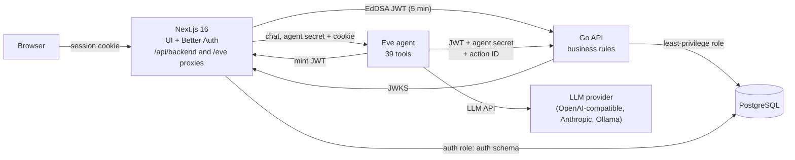

# OpenStock AI

A self-hosted inventory app for a single owner, with an AI assistant that can do everything the UI can, but only through audited API tools and only after you approve the changes that matter.

- **Tools-only agent.** A durable [Eve](https://www.npmjs.com/package/eve) agent talks to the Go API through 39 explicit tools. It has no SQL, no database connection and no shell.
- **Human approval for writes.** Every write is registered in Go as an `agent_action`. Deletes, archives, restores and large quantities are always confirmed, even when auto-approval is on.
- **Provider-agnostic.** Any OpenAI-compatible endpoint (OpenAI, OpenRouter, DeepInfra, vLLM, LM Studio), native Anthropic, or a local Ollama model.
- **Observable and tested.** An Agent runs page shows steps, tool calls, approvals, tokens and estimated cost. 17 end-to-end evals run against a throwaway stack.
- **Boring, correct core.** Go owns the business rules, PostgreSQL is the source of truth, the stock ledger is immutable, and every mutation is transactional and idempotent.

## Screenshots

| Dashboard                                    | Assistant with an approval card                           |
| -------------------------------------------- | --------------------------------------------------------- |
|  |  |

| Agent runs                                     | Inventory                                    |
| ---------------------------------------------- | -------------------------------------------- |
|  |  |

## Features

- **Inventory:** products with SKU, barcode, unit (with allowed decimals), minimum stock, cost and sale price; per-warehouse quantities; archive and restore instead of hard delete.
- **Catalogs:** categories, measurement units, warehouses and suppliers.
- **Purchases:** record a delivery as a purchase receipt that raises stock; browse purchase history.
- **Stock operations:** adjustments (entries and exits), transfers between warehouses and physical counts. Each one writes immutable ledger movements in the same transaction.
- **Restock view:** what is at or below its minimum.
- **Audit log:** who (human or AI) changed what, with before and after values.
- **CSV export:** product list with the same filters as the inventory page.
- **Dashboard:** stock value, low-stock count, recent movements, 30-day purchase spend, a low-stock list and recent movements.
- **Analytics:** stock valuation, product turnover (slow movers) and spend by supplier.
- **Assistant:** chat that reads and changes data through tools, replies in the language you write in, and asks for confirmation before sensitive changes.
- **Agent runs:** per-turn timeline with tool calls, approvals, token counts and an estimated cost.

## AI engineering

This is how the assistant is built. For the full tool catalog, the approval state machine and the eval list see [docs/AI.md](docs/AI.md).

### Tools only, never SQL

The agent lives in `apps/agent` and is an [Eve](https://www.npmjs.com/package/eve) agent (`defaultTools: false`, API-only sandbox that refuses to start). Its only capabilities are 39 typed tools in `apps/agent/agent/tools`. Each tool calls the Go REST API with a short-lived JWT for the signed-in owner plus the agent service secret. The agent container has no database credentials and no Docker socket, and the model is never given SQL or a shell. An eval (`no-sql`) checks that a request to "run SQL" ends without any write or SQL tool call, and another that an instruction hidden in a product description is treated as data.

### Progressive tool selection

Tool schemas are the biggest fixed cost of every model call, so the model starts with 10 core tools (product search and lookup, inventory, summary, low stock, movements, warehouses, units and `selectTools`). The other 29 tools are in nine groups (`catalog`, `stock`, `suppliers`, `purchases`, `warehouses`, `settings`, `audit`, `export`, `analytics`). The model enables groups for the current turn with `selectTools`, or by passing `nextAction` to `searchProducts`. Enabling is scoped to the user, conversation and turn.

This is an optimization, not a permission boundary: the model-facing list is filtered in `limitsMiddleware`, but Go still authorizes every call, including a guessed tool name. `AI_TOOL_SELECTION=all` exposes the full catalog.

### Writes go through Go, with human approval

Write tools are Eve workflow tools with an `approval` policy. Before anything runs, the tool registers an `agent_action` in Go (`POST /v1/agent-actions`) with a deterministic ID and the exact payload. Go decides whether approval is needed:

- **Always:** any `DELETE`, archive or restore, and quantities above 1000 (or initial stock above 1000).
- **Unless auto-approval is on:** everything else. The `automatic` setting is off by default in a fresh database, so every write waits for your confirmation; turn it on in Settings to let low-risk writes (such as creating a product) run immediately.

When approval is needed the chat shows a confirmation card. Approving calls Go with a human-actor token, never with the agent secret. When the tool finally runs, Go re-checks inside the mutation transaction that the action matches the exact operation and body that was approved, that its status is still pending and that the policy has not changed since. The policy lives in Go, not in the prompt, so the model cannot talk its way around it.

### Idempotency

The action ID is the SHA-256 of the conversation ID and the Eve tool call ID, shaped as a UUID. Eve checkpoints write tools as durable steps, so a replay after a crash reuses the same call ID and therefore the same action ID. That ID is also the `Idempotency-Key` for the mutation. Go claims the key and stores the response in the same transaction as the stock change, the ledger rows and the audit entry, so a retry returns the stored result instead of applying the change twice. Reusing an ID with a different payload is rejected (`ACTION_MISMATCH`, `IDEMPOTENCY_CONFLICT`).

### Token and step limits

`limitsMiddleware` wraps the language model at the provider boundary, so it also covers retries and compaction:

| Limit                 | Env                     | Default | Ceiling   |
| --------------------- | ----------------------- | ------- | --------- |
| Input per model call  | `AI_MAX_INPUT_TOKENS`   | 65,536  | 1,000,000 |
| Output per model call | `AI_MAX_OUTPUT_TOKENS`  | 2,048   | 32,768    |
| Steps per turn        | `AI_MAX_STEPS_PER_TURN` | 8       | 32        |

Input size is estimated from the serialized prompt and tool schemas as UTF-8 bytes plus a 1 KiB margin, which overestimates ordinary text, so the check is conservative. Each call also has a 120 s timeout. Truncated or filtered provider responses become explicit errors (`AI_OUTPUT_TRUNCATED`, `AI_INVALID_RESPONSE`) instead of a half-finished answer that looks like success. Eve compacts the history at 75% of the context window, and the agent also has fixed per-session budgets of 200,000 input and 10,000 output tokens.

### Result shaping and compaction

- Tool results are trimmed for the model (for example product summaries drop description and location) while the full result stays in the audit trail.
- Lists are paged with `hasMore` and `nextOffset`. Global totals come from a Go endpoint (`getInventorySummary`), so the model never adds up pages.
- With `AI_TOOL_RESULT_FORMAT=auto` (the default), uniform pages of four or more rows are sent to the model as [TOON](https://www.npmjs.com/package/@toon-format/toon) when that is at least 10% smaller in bytes than JSON. Otherwise, and with `json`, it stays JSON. Only the model's view changes; the UI and audit keep JSON.
- Audit results above 60 KB are replaced by a fingerprint (size, SHA-256, item count).
- Warehouses and units are cached for 15 seconds within a turn; stock is never cached, and any write clears the cache.
- CSV exports return a link to an authenticated Next route, so the file never passes through the model.

### Provider-agnostic model layer

`packages/server/src/ai` resolves `LLM_PROVIDER` to the AI SDK:

- `openai-compatible` (default): Chat Completions against `LLM_BASE_URL`. Works with OpenAI, OpenRouter, DeepInfra, vLLM and LM Studio.
- `anthropic`: the native Anthropic provider. Leave `LLM_BASE_URL` unset (a preset endpoint from another provider is rejected so the key is not leaked).
- `ollama`: the same Chat Completions client pointed at the `ollama` Compose service, no key needed. Small local models are noticeably weaker at tool use.

Configuration errors surface as `AI_NOT_CONFIGURED` in the chat, and secrets are never echoed.

### Evals, isolated

`pnpm agent:eval` starts a separate Compose project (`openstockai-eval`) with its own volumes and ports, creates a fixture owner and a fixture inventory through the public API, runs 17 evals with a real LLM, and always tears the stack down. The eval config refuses to run unless the target is local, the fixture owner is signed in and the store name matches the fixture, so it cannot be pointed at your real data. Evals check behavior, not wording: tools called and not called, the exact payload of an approval request, and the resulting stock read back through the API. See [docs/AI.md](docs/AI.md#evals) and [apps/agent/evals/README.md](apps/agent/evals/README.md).

### Observability

The **Agent runs** page lists every turn with its model, duration, steps, tool calls, approval outcomes, input and output tokens and estimated cost. Data comes from Eve's OpenTelemetry spans (metadata only; prompts and outputs are not recorded) joined with the `agent_actions` that Go stores. Token counts are the provider's; cost is an estimate that appears only if you set `LLM_PRICE_INPUT_PER_MTOK` and `LLM_PRICE_OUTPUT_PER_MTOK`. The agent also logs structured JSON lines for each model call and tool action.

## Architecture



- The browser only talks to Next.js. Next validates the Better Auth session, mints a five-minute EdDSA JWT (`sub` = user, `sid` = session) and forwards allow-listed routes to Go. Go verifies the JWT against Next's JWKS and checks that the session is still active.
- The agent authenticates the user's cookie through Next, then mints a JWT per call through an internal route guarded by `AGENT_SERVICE_SECRET`. Go marks those requests as AI actors only when that secret is present and valid.
- Go is the only service that reads or writes business data. Next only touches the `auth` schema.

More in [docs/ARCHITECTURE.md](docs/ARCHITECTURE.md).

## Tech stack

| Layer    | Technology                                                                                                   |
| -------- | ------------------------------------------------------------------------------------------------------------ |
| Web      | Next.js 16.4.5, React 19.3, TypeScript 6, Tailwind CSS 4, Radix UI, shadcn-style components                  |
| Auth     | Better Auth 1.7.7 (email and password, JWT plugin with EdDSA/Ed25519)                                        |
| API      | Go 1.27.3, chi 5.3, pgx 5.11, goose 3.28 (migrations), sqlc 1.31 (queries), golang-jwt 5.3                   |
| Database | PostgreSQL 18.6 with `pg_trgm`                                                                               |
| Agent    | Eve 1.5.0, Vercel AI SDK 7 (`ai` 7.0.183), `@ai-sdk/openai` 4.0.125, `@ai-sdk/anthropic` 4.0.110, TOON 4.4, Zod 4.6 |
| Tooling  | pnpm 11.25 workspaces, Node 24, ESLint 9, Prettier 3.9, Docker Compose                                       |

## Quick start

<!-- COMMANDS:BEGIN -->

Requirements: Docker with Compose. You also need an API key for an LLM provider, or a machine that can run Ollama.

```bash
cp .env.example .env
# edit .env: set LLM_PROVIDER, LLM_BASE_URL, LLM_API_KEY and LLM_MODEL
docker compose up -d --build
```

Open <http://localhost:3000> and create the owner account. Secrets and database credentials are generated for you on first start. There are no default credentials. Without a valid LLM key the app still works and the assistant reports that AI is not configured.

After editing `.env`, run `docker compose up -d` again (a plain `docker compose restart` does not re-read `.env`).

Other ways to run it:

```bash
# Start with fictional demo data (a small hardware store)
docker compose --profile demo up -d

# Use a local model instead of a hosted one
# (in .env: LLM_PROVIDER=ollama and a tool-capable model such as LLM_MODEL=qwen3:8b)
docker compose --profile ollama up -d

# Hot reload for development
docker compose -f compose.yaml -f compose.dev.yaml up --build

# Forgot the owner password (prompts for the new one and signs out every session)
docker compose run --rm reset-owner-password
# or non-interactively
printf '%s\n' "$NEW_PASSWORD" | docker compose run --rm -T reset-owner-password

# Delete everything, including the database volume
docker compose down -v

# Run the agent evals (needs a real LLM key; uses its own isolated stack)
pnpm agent:eval
```

<!-- COMMANDS:END -->

## Configuration

Set these in `.env` (see `.env.example` for the full list and provider presets).

| Variable                                                | Purpose                                                 | Default                     |
| ------------------------------------------------------- | ------------------------------------------------------- | --------------------------- |
| `LLM_PROVIDER`                                          | `openai-compatible`, `anthropic` or `ollama`            | `openai-compatible`         |
| `LLM_BASE_URL`                                          | Provider endpoint (optional for Anthropic)              | OpenAI URL / Ollama service |
| `LLM_API_KEY`                                           | Provider key. Optional for Ollama and local endpoints.  | none                        |
| `LLM_MODEL`                                             | Model ID (required)                                     | none                        |
| `LLM_PRICE_INPUT_PER_MTOK`, `LLM_PRICE_OUTPUT_PER_MTOK` | USD per million tokens, used only for the cost estimate | unset (no estimate)         |
| `AI_MAX_INPUT_TOKENS`                                   | Input limit per model call                              | 65536                       |
| `AI_MAX_OUTPUT_TOKENS`                                  | Output limit per model call                             | 2048                        |
| `AI_MAX_STEPS_PER_TURN`                                 | Model steps per user message                            | 8                           |
| `AI_TOOL_SELECTION`                                     | `progressive` or `all`                                  | `progressive`               |
| `AI_TOOL_RESULT_FORMAT`                                 | `auto` (TOON when smaller) or `json`                    | `auto`                      |
| `WEB_PORT`                                              | Published web port                                      | 3000                        |
| `API_PORT`                                              | Published Go API port                                   | 8087                        |
| `POSTGRES_PORT`                                         | Published PostgreSQL port                               | 55432                       |

Internal secrets (`BETTER_AUTH_SECRET`, `AGENT_SERVICE_SECRET`, database passwords) are generated and never need to be set by hand.

## Local development without Docker

The hot-reload Compose override above is the easiest development setup. To run the processes on the host instead you need Node 24, pnpm, Go 1.27 and a PostgreSQL 18 server, plus the variables that `compose.yaml` passes to each service set in `.env`: `DATABASE_URL`, `API_DATABASE_URL`, `AUTH_DATABASE_URL`, `API_DATABASE_PASSWORD`, `AUTH_DATABASE_PASSWORD`, `BETTER_AUTH_SECRET`, `AGENT_SERVICE_SECRET` (at least 32 characters) and the service URLs (`BETTER_AUTH_URL`, `BETTER_AUTH_JWKS_URL`, `API_BASE_URL`, `EVE_BASE_URL`).

```bash
pnpm install
pnpm db:migrate         # apply goose migrations
pnpm db:provision       # create the least-privilege API and auth logins
pnpm api:dev            # Go API
pnpm agent:dev          # Eve agent on 127.0.0.1:4273
pnpm dev                # Next.js on 127.0.0.1:3017
```

Useful scripts from the root `package.json`:

| Script                             | What it does                                             |
| ---------------------------------- | -------------------------------------------------------- |
| `pnpm build`, `pnpm start`         | Build and serve the web app                              |
| `pnpm agent:build`                 | Build the Eve agent                                      |
| `pnpm db:generate`                 | Regenerate sqlc Go code from `apps/api/db`               |
| `pnpm api:generate`                | Regenerate the TypeScript API client from `openapi.json` |
| `pnpm auth:schema`                 | Regenerate the Better Auth schema                        |
| `pnpm owner:reset-password`        | Reset the owner password from the terminal               |
| `pnpm format`, `pnpm format:check` | Prettier on the TypeScript sources                       |

## Testing

There is no CI and no browser (E2E) suite in this repository. Everything runs locally:

| Command                                                        | Covers                                                                                    |
| -------------------------------------------------------------- | ----------------------------------------------------------------------------------------- |
| `pnpm typecheck`                                               | TypeScript across all workspaces                                                          |
| `pnpm lint`                                                    | ESLint                                                                                    |
| `pnpm test:architecture`                                       | Module boundaries for Next, packages and Go                                               |
| `pnpm test:go`                                                 | Go unit tests (the PostgreSQL ones are skipped)                                           |
| `pnpm test:integration`                                        | Go tests including PostgreSQL, in a disposable database created and dropped by the script |
| `pnpm test:auth`                                               | Better Auth single-owner flow, in a disposable database                                   |
| `pnpm test:agent`                                              | Agent tools, tool selection, approval flow, TOON output and trace parsing                 |
| `pnpm test:assistant`, `pnpm test:store`, `pnpm test:contract` | Chat UI, client state and OpenAPI response validation                                     |
| `pnpm test:config`, `pnpm test:tooling`                        | LLM and server configuration, repo tooling                                                |
| `pnpm agent:eval`                                              | LLM evals on an isolated stack (costs tokens)                                             |

`pnpm test:integration` and `pnpm test:auth` need `DATABASE_URL` to point at a PostgreSQL server where the user can create databases.

## Security model

- **Single owner.** The first account created becomes the owner and sign-up is then closed. This is enforced in the Better Auth hook and by a unique index on `auth."user" ((true))`, so a race cannot create a second user. Passwords need at least 12 characters. The owner password can be reset from the terminal.
- **Short-lived JWTs.** Go accepts only EdDSA tokens with the expected issuer and audience, five minutes of lifetime and an active session. The agent gets one per tool call.
- **Agent service secret.** Requests that carry `X-Agent-Secret` are treated as AI actors. Only they can register actions, and only a human-actor token can approve them.
- **Least-privilege database roles.** Migrations run as the owner. At runtime the Go API uses a role that cannot update the ledger tables and cannot delete products, and the auth role can only touch the `auth` schema. The agent has no database credentials at all.
- **Immutable history.** Stock movements and audit logs reject `UPDATE` and `DELETE` with a trigger. A correction is a new compensating movement.
- **No secrets in the repository.** Only `.env.example` with placeholders is tracked. Secrets are generated locally.
- **Content stays out of traces.** OpenTelemetry capture records metadata only, not prompts or tool outputs.

Limits worth knowing: the agent service holds the shared secret and relays your approval click to Go, so it is part of the trusted computing base. The app is meant for a trusted local network or behind your own reverse proxy with HTTPS; it has no built-in TLS.

## Project structure

```text
apps/
  api/            Go API: internal/{app,modules/inventory,platform,transport/http}, db/ (goose + sqlc)
  web/            Next.js app: src/{app,shell,features,shared,server}
  agent/          Eve agent: agent/{tools,lib,instrumentation,channels}, evals/, tests/
packages/
  api-client/     OpenAPI-generated types, runtime contract validation, agent-run schemas
  server/         env parsing, HTTP helpers, LLM provider layer
docs/             ARCHITECTURE.md, AI.md
docker/postgres/  PostgreSQL image
scripts/          setup, migrations, sqlc, integration and auth checks
tests/            repo-level architecture test
```

## Roadmap

Ideas, not promises:

- Internationalized UI (the assistant already replies in your language).
- Import products and purchases from a PDF or spreadsheet.
- More chat channels besides the web app.
- A hosted read-only demo.
- A token and latency benchmark across models, using the existing evals.

## License

[MIT](LICENSE) © 2026 DravenDou
