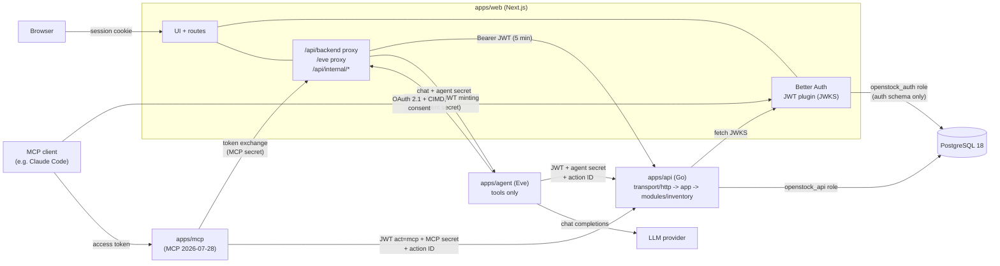
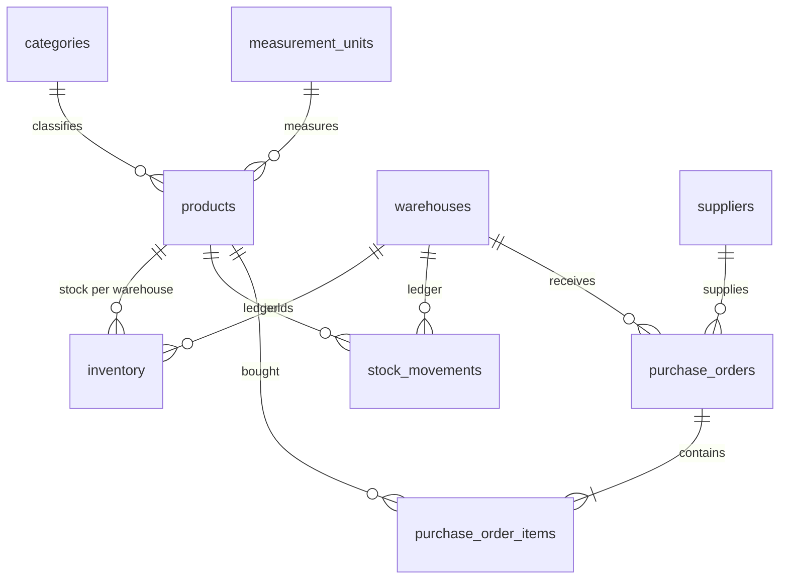
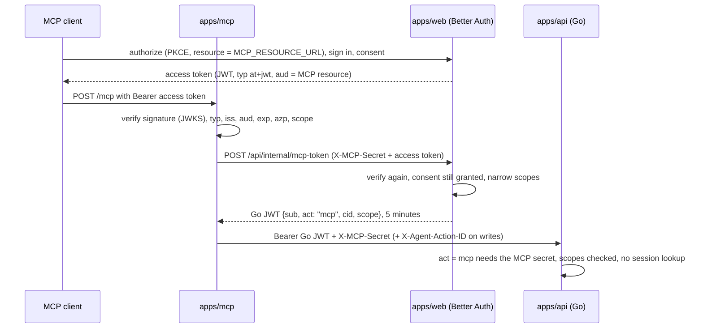

# Architecture

OpenStock AI is a small modular monorepo for a single-owner inventory app. Next.js owns the UI and identity, Go owns every business rule, PostgreSQL is the source of truth, and an Eve agent provides the AI assistant by calling the Go API through explicit tools. An MCP server (`apps/mcp`) exposes a curated set of the same operations to external MCP clients, such as Claude Code, behind OAuth 2.1 and the same approval policy.

- [System overview](#system-overview)
- [Modules and boundaries](#modules-and-boundaries)
- [Request flow](#request-flow)
- [Authentication](#authentication)
- [Data model](#data-model)
- [Mutations: transactions and idempotency](#mutations-transactions-and-idempotency)
- [MCP server](#mcp-server)
- [Design decisions and trade-offs](#design-decisions-and-trade-offs)
- [Code generation](#code-generation)
- [Deployment shape](#deployment-shape)
- [Known limitations](#known-limitations)

The agent and the MCP tool surface are documented in [AI.md](AI.md).

## System overview



| Process       | Port (default)    | Talks to                                      |
| ------------- | ----------------- | --------------------------------------------- |
| Next.js (web) | 3000 (Compose)    | Go API, Eve agent, PostgreSQL (`auth` schema) |
| Go API        | 8087              | PostgreSQL, Next.js (JWKS)                    |
| Eve agent     | 4273 (internal)   | Go API, Next.js (internal routes), LLM        |
| MCP server    | 3100 (published)  | Go API, Next.js (JWKS, token exchange)        |
| PostgreSQL    | 55432 (published) | n/a                                           |

## Modules and boundaries

### Go (`apps/api`)

```text
cmd/api/                       process entry: serve, --migrate, --provision
internal/
  app/                         composes services (the only place that wires modules)
  modules/inventory/           business rules: products, stock, purchases, counts,
                               catalogs, settings, analytics, agent actions, approval policy
  platform/                    infrastructure, imports no module, app or transport
    apperror/ auth/ database/ principal/ quantity/ validate/
  transport/http/              REST adapter: router, auth middleware, routes, transactions
  architecture/                Go test that checks the boundaries
db/
  migrations/00001_init.sql    goose migration (schema, triggers, roles, grants)
  queries/*.sql                sqlc queries
openapi.json                   REST contract
```

Rules:

- A module never imports another module. Today there is one (`inventory`), and the rule keeps the next one from coupling to it.
- `platform` is infrastructure. It never imports `modules`, `app` or `transport`.
- `app` composes services, `transport/http` adapts REST to them, `cmd/api` boots processes.
- Purchase and stock transactions, and their approvals, live inside `inventory`.
- SQL lives in `apps/api/db`. The `database` package in `platform` is sqlc output and is never edited by hand.
- Every route lives under `/v1`; handlers decode, call a service method and encode. Business rules are not in handlers.

### Next.js (`apps/web`)

```text
src/
  app/        routes only: pages, /api/backend, /api/auth, /eve, /api/internal/*, /api/exports
  shell/      composition: app shell, auth gate, route table, wiring of features
  features/   <name>/{views,components,lib}: approvals, assistant, agent-runs,
              catalogs, consent, dashboard, inventory, purchases, settings
  shared/     code common to features: UI primitives, API hooks, state, lookups
  server/     server-only code: Better Auth instance, forwarding to Go
```

Rules:

- A feature imports only itself and `shared`. Composition between features happens in `shell` or `app`.
- `shared` imports no feature, shell, app or server code.
- No client component reaches `server`, even through intermediate imports.
- `apps/agent` and `apps/mcp` can import `packages/*` but never another app. Packages never import from `apps`.
- `@openstockai/api-client` stays client-safe and does not depend on `@openstockai/server`.

### Shared packages (`packages/*`)

| Package                   | Contents                                                                                                                |
| ------------------------- | ----------------------------------------------------------------------------------------------------------------------- |
| `@openstockai/api-client` | Generated OpenAPI types, a typed `request` helper, runtime response validation, Agent runs schemas                      |
| `@openstockai/server`     | Environment parsing, HTTP helpers (origin check, service secrets, bounded bodies), LLM config, model wrapper and limits |
| `@openstockai/schemas`    | Strict Zod input schemas for the inventory operations, shared by the Eve agent and the MCP server                       |

All three are consumed as TypeScript source (no build step).

### How the boundaries are enforced

`pnpm test:architecture` runs `tests/architecture.test.mjs`, which builds the import graph from the source and fails with the offending edges:

- Web: `shared` only imports `shared`; `server` only imports `server` and `shared`; a `feature` imports `shared` and itself; `shell` imports `shell`, `features` and `shared`.
- Web client components (`"use client"`) never reach `server`, walking imports transitively.
- `apps/agent` never imports `apps/web`; `apps/mcp` imports only `packages`; `packages` never import from `apps`; `schemas` imports no workspace package; `api-client` does not import `server`.
- Go: modules do not import each other, and `platform` does not import `modules`, `app` or `transport`. The same Go rules are also checked by `internal/architecture/boundaries_test.go`, which runs with `pnpm test:go`.

The checks are plain local commands (`pnpm test:architecture`, `pnpm test:go`); the repository has no CI workflow.

## Request flow

### A normal page action

1. The browser calls `/api/backend/<path>` on Next.js with its session cookie.
2. The route handler checks the origin on writes, looks up the Better Auth session and obtains a JWT. Only routes listed in the OpenAPI contract are forwarded; the agent session routes are internal.
3. Go verifies the JWT, loads the active session, and starts a database transaction for the request.
4. A mutation sends an `Idempotency-Key` (UUID). Go claims it, applies the change, writes the ledger and audit rows and stores the response in the same transaction.
5. The typed client (`request()` in `@openstockai/api-client`) validates every response against the OpenAPI schemas at runtime, in the browser and in the agent.

### An assistant turn

1. The chat sends the message to `/eve/v1/session/...` on Next.js. Next checks the origin and the session, verifies that the conversation belongs to this user (Go keeps the `agent_sessions` binding) and proxies to Eve with the agent secret and the user's cookie.
2. Eve authenticates the request by calling `/api/internal/agent-auth`, which returns the user and session IDs only for a valid cookie and secret.
3. Before each model step, the agent picks the tools to advertise (progressive selection) and wraps the model with the token and step limits.
4. A tool asks Next for a JWT (`/api/internal/agent-token`), registers an `agent_action` in Go and, for writes, waits for approval when Go says it is required.
5. The tool calls the real Go endpoint with the JWT, the agent secret and the action ID. Go re-checks the action inside the mutation transaction.

The approval details are in [AI.md](AI.md#approval-lifecycle).

## Authentication

### Owner onboarding

- Better Auth handles email and password in Next.js. The `auth` schema in PostgreSQL holds its tables.
- On a fresh database the UI asks for **Create owner account**. A `before` hook on user creation rejects sign-up once any user exists (`SIGNUP_CLOSED`), and a unique index on `auth."user" ((true))` makes a second row impossible even under a race.
- Passwords need at least 12 characters, sessions last seven days and Better Auth rate limits its endpoints (stored in the database).
- The owner password can be reset from the terminal (`docker compose run --rm reset-owner-password`, or `pnpm owner:reset-password` locally). The script hashes with Better Auth's own function, accepts the password only from a prompt or stdin, revokes the owner's sessions and disconnects every MCP client (it deletes the OAuth consents, access tokens and refresh tokens).

### JWT and JWKS

- Next.js signs a JWT per request with an Ed25519 key (`EdDSA`) managed by Better Auth's JWT plugin. The payload is `sub` (user ID) and `sid` (session ID), with issuer `BETTER_AUTH_URL`, audience `JWT_AUDIENCE` and a five-minute expiry.
- Go fetches the public keys from Next.js at `/api/auth/jwks`. It accepts only Ed25519 keys and the `EdDSA` method, requires issuer, audience and expiry to be valid, and then checks that the session in the `auth` schema is still active and unexpired. Signing out therefore takes effect immediately, not after the token expires.
- The Go principal carries the user ID, session ID and an actor type: `human`, `ai` when a valid `X-Agent-Secret` accompanies a session token, or `mcp` for a token minted for an MCP client (see [MCP server](#mcp-server)).

### Agent identity

The agent never holds a user token. For each call it posts the user and session IDs, with the agent secret, to an internal Next.js route that checks the session in the database and signs a short-lived JWT. When the owner approves an action, Eve's approval response policy calls another internal route that signs a token **without** the agent secret, so Go sees a human actor. See [AI.md](AI.md#approval-lifecycle).

### MCP clients

External MCP clients sign in with OAuth 2.1, with Better Auth as the authorization server. The MCP server is the resource server and never forwards the client's token: it exchanges it, per call, for a short-lived Go token with actor `mcp`. The full chain is described in [MCP server](#mcp-server).

## Data model

`apps/api/db/migrations/00001_init.sql` is the baseline. `00002_mcp_actor.sql` adds the `mcp` actor and the actor and OAuth client columns of `agent_actions`; `00003_auth_oauth_provider.sql` adds the OAuth tables in the `auth` schema (generated with `pnpm auth:schema`). All business tables are single-tenant: there is no tenant or organization column.



| Table                                     | Purpose                                                                                                                                                                                                        |
| ----------------------------------------- | -------------------------------------------------------------------------------------------------------------------------------------------------------------------------------------------------------------- |
| `measurement_units`                       | Unit code, name, symbol and `decimals` (0 to 3). Seeded with pieces, boxes, packs, kg, g, l, ml, m and m2                                                                                                      |
| `categories`, `warehouses`, `suppliers`   | Lookup tables with unique names. One warehouse ("Main warehouse") is seeded                                                                                                                                    |
| `products`                                | SKU (unique, case-insensitive), barcode, unit, minimum, cost and sale price, `active` or `archived` status. A trigram index backs search over name, SKU and barcode                                            |
| `inventory`                               | Current quantity per `(warehouse, product)`, never negative                                                                                                                                                    |
| `stock_movements`                         | Append-only ledger: `initial`, `purchase`, `sale`, `adjustment_in/out`, `transfer_in/out`, `return_in/out`, with the actor (`human`, `ai`, `mcp`, `system`)                                                    |
| `purchase_orders`, `purchase_order_items` | A receipt: warehouse, optional supplier, unique reference, lines with quantity and cost                                                                                                                        |
| `audit_logs`                              | Append-only: actor, action, resource, `before` and `after` JSON, idempotency key and agent action ID                                                                                                           |
| `idempotency_keys`                        | `(user, key)` with operation, request hash and stored response                                                                                                                                                 |
| `agent_actions`                           | Every tool call the agent or an MCP client registers: actor (`ai` or `mcp`), OAuth client ID, operation, input, result, `status` and `approval_status`                                                         |
| `agent_sessions`                          | Binds an Eve conversation to the user who started it                                                                                                                                                           |
| `settings`                                | A single row of JSON settings                                                                                                                                                                                  |
| `auth.*`                                  | Better Auth tables (`user`, `session`, `account`, `verification`, `jwks`, `rateLimit`) and the OAuth provider's (`oauthClient`, `oauthConsent`, `oauthAccessToken`, `oauthRefreshToken`, `oauthResource`, ...) |

Design points:

- **Exact numbers.** Money is `numeric(18,2)` and quantities are `numeric(18,3)`, exposed as decimal strings. Go maps quantities to a fixed-point `quantity.Amount` (thousandths) so there is no floating-point arithmetic on stock.
- **Immutable ledger.** `forbid_ledger_change()` is a `BEFORE UPDATE OR DELETE` trigger on `stock_movements` and `audit_logs` that raises an exception. The runtime database role also has no `UPDATE` on those tables. A correction is a new compensating movement.
- **Single-row settings.** `settings.id` is a boolean primary key constrained to `true`, and the migration seeds the row. The runtime role can only read and update it. The fields enforced by the backend are the ones used by the approval policy (`automatic`); the rest (`store`, `currency`, `timezone`, `lowStock`, `voice`) are preferences stored as JSON. `lowStock` toggles the restocking alert in the assistant panel and `voice` makes the browser read replies aloud; both are browser-side preferences that Go stores but does not enforce. `automatic` defaults to `false`.
- **Archive instead of delete.** `DELETE /v1/products/{id}` archives a product; history is kept and `POST /v1/products/{id}/restore` brings it back. Categories, warehouses and suppliers can be deleted only when nothing references them.
- **Roles.** The migration owner creates the schema. `openstock_api` gets read and write on business tables (no `UPDATE` on the two ledgers, `DELETE` only on the three lookup tables) and read access to the auth users and sessions, and nothing on the OAuth tables. `openstock_auth` gets full access to the `auth` schema only. `openstock_api` also has `UPDATE` on `auth.session."createdAt"` only, which lets it take a `FOR SHARE` row lock when it checks that the session is active, without write access to tokens or other session data. Login roles for each are provisioned by `pnpm db:provision` (or the Compose provision step).

## Mutations: transactions and idempotency

Every state change goes through one function, `Service.Mutate` in `modules/inventory/mutations.go`:

1. Require a UUID idempotency key and, for session-backed actors (`human`, `ai`), check in the transaction that the session is still active.
2. Claim the key (scoped to the user), lock the row and compare the stored operation and request hash. A different operation or body under the same key is `IDEMPOTENCY_CONFLICT`. If a response is already stored, return it and commit: a replay never re-runs the change or re-checks approval.
3. For AI and MCP actors, load the registered action and verify that it was registered by the same actor (and, for MCP, the same OAuth client), that its operation and body hash match what is being executed and that it is still `pending` (`ACTION_MISMATCH`), that it was not rejected (`ACTION_REJECTED`), and that the approval policy is satisfied (`ACTION_STALE` if the policy now requires approval for an action registered as not requiring it, `APPROVAL_REQUIRED` if approval is still missing).
4. Run the change, write the audit row and mark the agent action `completed` with its result.
5. Store the response on the idempotency record and commit. Stock, ledger, audit, action and idempotency record are all in one transaction, so a failure leaves none of them behind.

The same function serves every actor; the only difference is step 3. Because the response is stored in the same transaction as the change, a client that times out can retry with the same key and gets either the stored result or a clean slate, never a half-applied change.

## MCP server

`apps/mcp` is a Node service built on the official MCP TypeScript SDK v2 (`@modelcontextprotocol/server` 2.4.0) for protocol revision 2026-07-28. It serves Streamable HTTP at `POST /mcp` through `createMcpHandler`, adapted to `node:http` by `@modelcontextprotocol/node`. Like the agent it has no database credentials: every operation is a call to the Go API through `@openstockai/api-client`, and every write goes through `agent_actions`. The tools, resources and skills, and how approvals work over the protocol, are in [AI.md](AI.md#mcp-server).

```text
apps/mcp/
  src/
    app.ts        fetch handler: /mcp, RFC 9728 metadata, /health, Host and Origin checks
    auth.ts       access-token verification against the JWKS, scopes
    upstream.ts   token exchange, Go calls, error mapping
    reads.ts      read tools
    writes.ts     write tools and the approval protocol (MRTR)
    resources.ts  resources and the product resource template
    server.ts     McpServer factory: registration order, cache hints, skills
  skills/<name>/SKILL.md
  tests/          in-process tests with the SDK Client against fake upstreams
```

### Identity chain



1. **Client to MCP server.** The client finds the protected-resource metadata (RFC 9728) at `/.well-known/oauth-protected-resource/mcp` on the MCP server, which names `BETTER_AUTH_URL` as the authorization server. A request without a valid token gets `401` with a `WWW-Authenticate` challenge pointing there. The MCP server verifies the access token locally against the web app's JWKS: EdDSA, `typ: at+jwt`, issuer `BETTER_AUTH_URL`, an audience that contains `MCP_RESOURCE_URL`, expiry and `azp` (the client). Every request needs `inventory:read`; write tools also need `inventory:write` and answer `403 insufficient_scope` without it.
2. **Token exchange, not passthrough.** The access token's audience is the MCP server, and the spec forbids passing it on. For every tool call and resource read the MCP server posts it, with `X-MCP-Secret`, to `POST /api/internal/mcp-token`. Next.js verifies it again, checks that the owner's consent for that client still exists, narrows the scopes to what the consent allows and signs a five-minute Go token `{sub, act: "mcp", cid, scope}` with the same EdDSA key and audience as session tokens. Revoking the client under Settings, Connected apps therefore takes effect on its next call.
3. **MCP server to Go.** Go accepts `act: "mcp"` only together with a valid `X-MCP-Secret`, never with `X-Agent-Secret`, and rejects `X-MCP-Secret` on a session token. The token has no session ID, so there is no session lookup; instead every MCP call needs `inventory:read` and every non-GET call `inventory:write` (`403 INSUFFICIENT_SCOPE`). The principal is `mcp` with the OAuth client ID, which lands in `agent_actions` and in the audit metadata. When `MCP_SERVICE_SECRET` is unset, Go rejects every MCP token and the exchange route answers `503 MCP_DISABLED`.

### Authorization server

Better Auth's `mcp()` plugin (built on `@better-auth/oauth-provider`) turns the web app into an OAuth 2.1 authorization server, and `cimd()` adds Client ID Metadata Documents with the `mcp-2026-07-28` profile:

- A client identifies itself with an HTTPS `client_id` that points to its metadata document, so there is no registration step. Dynamic Client Registration stays off (it is deprecated in 2026-07-28), and the discovery document advertises no registration endpoint.
- Authorization code with PKCE (S256), resource indicators (RFC 8707: the access token's audience is the MCP resource), `iss` in authorization responses (RFC 9207), and rotating refresh tokens with `offline_access`.
- RFC 8414 and OpenID discovery are served at the domain root (`/.well-known/oauth-authorization-server`, `/.well-known/openid-configuration`), because the issuer is `BETTER_AUTH_URL` without a path.
- Sign-in is the normal owner sign-in. The consent page (`/consent`) verifies the signed authorization request, shows the client's self-declared name as unverified next to its `client_id` host, and explains both scopes.
- Session JWTs and access tokens share the signing key, so the HTTP `/api/auth/token` route and the `set-auth-jwt` header are disabled; Next.js still mints session JWTs in-process for its own calls to Go. A session JWT is not a valid access token (wrong `typ`, no `azp`, wrong audience), and an access token cannot reach Go directly (wrong audience).

### Secrets and network

| Secret               | Generated by     | Given to      | Purpose                                      |
| -------------------- | ---------------- | ------------- | -------------------------------------------- |
| `MCP_SERVICE_SECRET` | `docker/init.sh` | web, api, mcp | Proves that a call comes from the MCP server |
| `MCP_STATE_SECRET`   | `docker/init.sh` | mcp           | HMAC key for the MRTR `requestState`         |

`docker/entrypoint.sh` exports only the secrets a service needs as environment variables (`OPENSTOCK_SECRETS_SKIP` skips the rest): the agent gets neither MCP secret, and the MCP server gets no database, auth or agent secret in its environment. Every service still mounts the whole secrets volume, so the skipped files remain readable (see Known limitations). The MCP server validates `Host` and `Origin` against DNS rebinding, and Compose publishes it on `127.0.0.1:3100`.

### Protocol choices

- **Stateless.** Revision 2026-07-28 has no initialize handshake and no `Mcp-Session-Id`, and `createMcpHandler` builds a server per request. Between the rounds of an approval the only state is the signed `requestState` and the action row in Go, so the service needs no sticky sessions. Clients on 2025-11-25 and earlier are served by the SDK's stateless legacy path, which turns an input request into a classic `elicitation/create`.
- **Caching.** `tools/list` carries a ten-minute `public` cache hint (it is identical for every caller); resources are `private` with short TTLs (see [AI.md](AI.md#mcp-server)).
- **Not used.** Sampling, Roots and Logging are deprecated in 2026-07-28 and nothing here needs them. Tasks (`io.modelcontextprotocol/tasks`) are not implemented: the SDK has no server-side support, and no operation runs long enough to need a task handle.

## Design decisions and trade-offs

**Go owns the business rules.** Validation, stock arithmetic, the approval policy, idempotency and audit are implemented once, in Go, behind a REST API. The web UI and the agent are two clients of the same rules, so the assistant cannot do anything the API would not allow a human, and a prompt change cannot weaken a rule. The cost is a second language and a generated TypeScript client (`openapi.json` is the contract), plus a network hop for every agent tool call.

**The AI never gets SQL.** The model can only call typed tools, each mapped to one REST endpoint, with strict input schemas. The agent process has no database credentials. A text-to-SQL agent would be more flexible, but its blast radius is the whole database and its writes could not be bound to an approval. Here the worst a manipulated model can do is call a tool, and every write that matters stops at an approval. The cost is that a new capability needs a new endpoint and tool.

**Single tenant.** The app serves one owner, so business tables have no tenant column and Better Auth runs with a closed sign-up. This removes a class of cross-tenant bugs and keeps queries simple. The cost is that multi-user or multi-organization use would need a schema change and a scoping pass over every query; it is not a configuration switch.

**Approvals are stored in Go (`agent_actions`), not in the agent.** The agent is a durable workflow that can restart or park for days; the authoritative record of what was proposed, approved and executed must not depend on its state. Storing the action in Go lets the mutation transaction verify the approval atomically with the change, bind it to the exact payload by hash, and re-evaluate the policy at execution time (so turning auto-approval off between registration and execution invalidates a stale action). It also gives the audit log and the Agent runs page a source that survives agent restarts and trace expiry. The cost is one extra API call per tool call (registration), which reads also pay so that the audit trail is complete.

**An immutable ledger instead of mutable counters.** `inventory` holds the current quantity for fast reads, but every change also appends a `stock_movements` row in the same transaction, and database triggers reject updates and deletes on the ledger and the audit log. Corrections are compensating movements. The cost is that mistakes cannot be edited away, which is the intent.

**The MCP server is its own service and exchanges tokens.** It could have been a route in Next.js, which already holds the session and the signing key. A separate process keeps the protocol SDK, its HTTP surface and its state secret out of the web app, gives it its own port and secrets, and makes the trust boundary explicit: it reaches Go only with a token Next.js minted for a client the owner still allows, and the scopes travel in that token so Go enforces them too. The cost is one internal HTTP call per tool call for the exchange, and one more container.

**JWT per request with a live session check.** Short-lived EdDSA tokens avoid shared sessions between Next.js and Go, but a valid token alone is not enough: Go also checks the session row, so signing out takes effect immediately. The cost is a session lookup inside every mutation transaction.

## Known limitations

- The agent service holds the shared secret and relays the owner's approval to Go, so it is part of the trusted computing base. Go enforces that approval needs a human-actor token, but the token is minted by Next.js on the agent's request after it verifies the user's cookie.
- There is no built-in TLS. Run it on a trusted network or behind a reverse proxy with HTTPS.
- The `settings` document is one JSON row. Only `automatic` is enforced by the backend; the other fields are stored preferences.
- Only one business module exists today, so the module-isolation rule is enforced but not yet exercised by a second module.
- Agent observability in production depends on an undocumented Eve internal; see [AI.md](AI.md#observability).
- The MCP server holds `MCP_SERVICE_SECRET`, so it is trusted like the agent. Go's rule that an MCP client may approve only low-risk actions holds against a hostile client, not against a compromised MCP server.
- CIMD needs the web container to fetch the client's metadata document over HTTPS, so it needs outbound internet access. Outside loopback the MCP resource must be HTTPS, and `MCP_RESOURCE_URL` must be the exact public URL clients use.
- A revoked client keeps its access token until it expires. It can still list tools and skills (static, no inventory data), but every tool call and resource read fails at the token exchange.
- Every service mounts the whole secrets volume; `OPENSTOCK_SECRETS_SKIP` only limits which secrets are exported as environment variables, so the skipped files stay readable by a compromised service. Per-service secret mounts would fix it.

## Code generation

| What                 | Source                                   | Command             | Output                                                            |
| -------------------- | ---------------------------------------- | ------------------- | ----------------------------------------------------------------- |
| Go query layer       | `apps/api/db/queries/*.sql` + migrations | `pnpm db:generate`  | `apps/api/internal/platform/database/*.sql.go` (sqlc 1.31)        |
| TypeScript API types | `apps/api/openapi.json`                  | `pnpm api:generate` | `packages/api-client/src/generated.ts`, `runtime.json`            |
| Better Auth schema   | `apps/web/src/server/auth.ts`            | `pnpm auth:schema`  | SQL for the `auth` tables, to review before adding to a migration |

`openapi.json` is maintained by hand as the REST contract. `pnpm api:generate` turns it into typed paths for `request()` and into `runtime.json`, which the client uses to validate responses and the `/api/backend` proxy uses as its allow-list of public routes. Generated files are never edited by hand.

## Deployment shape

Docker Compose runs PostgreSQL, a one-shot migration and provisioning step, the Go API, the Next.js app, the Eve agent and the MCP server. Only the web port needs to be reachable by a browser, and the MCP port by MCP clients; the API and database ports are published on localhost only in the default Compose file. The stack serves plain HTTP. For any exposure beyond localhost, put a TLS reverse proxy in front of the web port and set `BETTER_AUTH_URL` to the `https://` origin, which is what turns on secure cookies. The authentication rate limit is one shared bucket per path because no client-IP header is trusted (see the README security model). See the [README](../README.md#quick-start) for commands.
