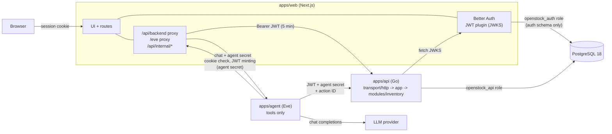
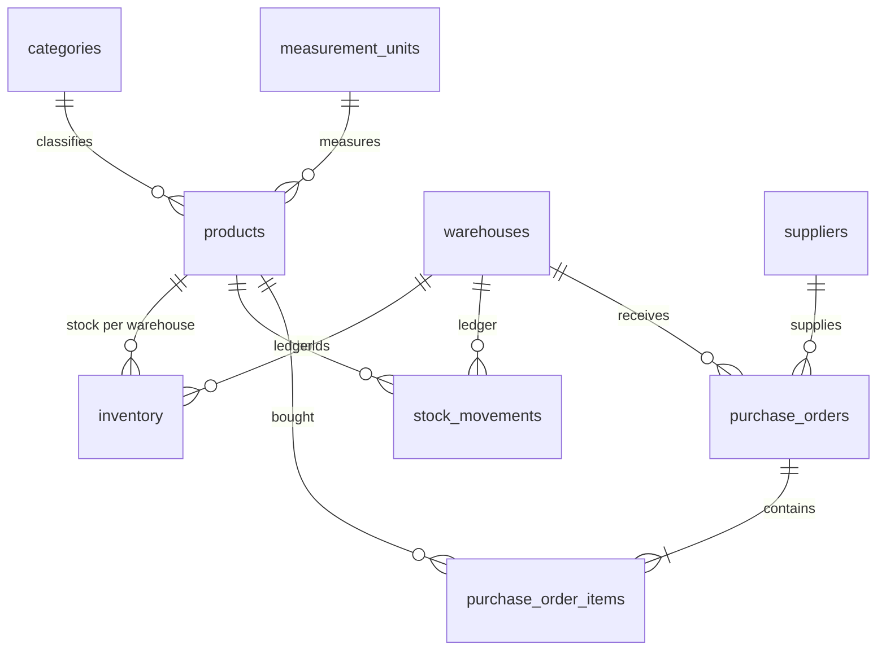

# Architecture

OpenStock AI is a small modular monorepo for a single-owner inventory app. Next.js owns the UI and identity, Go owns every business rule, PostgreSQL is the source of truth, and an Eve agent provides the AI assistant by calling the Go API through explicit tools.

- [System overview](#system-overview)
- [Modules and boundaries](#modules-and-boundaries)
- [Request flow](#request-flow)
- [Authentication](#authentication)
- [Data model](#data-model)
- [Mutations: transactions and idempotency](#mutations-transactions-and-idempotency)
- [Code generation](#code-generation)
- [Deployment shape](#deployment-shape)

The agent is documented in [AI.md](AI.md).

## System overview



| Process       | Port (default)    | Talks to                                      |
| ------------- | ----------------- | --------------------------------------------- |
| Next.js (web) | 3000 (Compose)    | Go API, Eve agent, PostgreSQL (`auth` schema) |
| Go API        | 8087              | PostgreSQL, Next.js (JWKS)                    |
| Eve agent     | 4273 (internal)   | Go API, Next.js (internal routes), LLM        |
| PostgreSQL    | 55432 (published) | n/a                                           |

## Modules and boundaries

### Go (`apps/api`)

```text
cmd/api/                       process entry: serve, --migrate, --provision
internal/
  app/                         composes services (the only place that wires modules)
  modules/inventory/           business rules: products, stock, purchases, counts,
                               catalogs, settings, analytics, agent actions, approval policy
  platform/                    infrastructure, imports no module, app or transport
    apperror/ auth/ database/ principal/ quantity/ validate/
  transport/http/              REST adapter: router, auth middleware, routes, transactions
  architecture/                Go test that checks the boundaries
db/
  migrations/00001_init.sql    goose migration (schema, triggers, roles, grants)
  queries/*.sql                sqlc queries
openapi.json                   REST contract
```

Rules:

- A module never imports another module. Today there is one (`inventory`), and the rule keeps the next one from coupling to it.
- `platform` is infrastructure. It never imports `modules`, `app` or `transport`.
- `app` composes services, `transport/http` adapts REST to them, `cmd/api` boots processes.
- Purchase and stock transactions, and their approvals, live inside `inventory`.
- SQL lives in `apps/api/db`. The `database` package in `platform` is sqlc output and is never edited by hand.
- Every route lives under `/v1`; handlers decode, call a service method and encode. Business rules are not in handlers.

### Next.js (`apps/web`)

```text
src/
  app/        routes only: pages, /api/backend, /api/auth, /eve, /api/internal/*, /api/exports
  shell/      composition: app shell, auth gate, route table, wiring of features
  features/   <name>/{views,components,lib}: assistant, agent-runs, catalogs,
              dashboard, inventory, purchases, settings
  shared/     code common to features: UI primitives, API hooks, state, lookups
  server/     server-only code: Better Auth instance, forwarding to Go
```

Rules:

- A feature imports only itself and `shared`. Composition between features happens in `shell` or `app`.
- `shared` imports no feature, shell, app or server code.
- No client component reaches `server`, even through intermediate imports.
- `apps/agent` can import `packages/*` but never `apps/web`. Packages never import from `apps`.
- `@openstockai/api-client` stays client-safe and does not depend on `@openstockai/server`.

### Shared packages (`packages/*`)

| Package                   | Contents                                                                                                               |
| ------------------------- | ---------------------------------------------------------------------------------------------------------------------- |
| `@openstockai/api-client` | Generated OpenAPI types, a typed `request` helper, runtime response validation, Agent runs schemas                     |
| `@openstockai/server`     | Environment parsing, HTTP helpers (origin check, service secret, bounded bodies), LLM config, model wrapper and limits |

Both are consumed as TypeScript source (no build step).

### How the boundaries are enforced

`pnpm test:architecture` runs `tests/architecture.test.mjs`, which builds the import graph from the source and fails with the offending edges:

- Web: `shared` only imports `shared`; `server` only imports `server` and `shared`; a `feature` imports `shared` and itself; `shell` imports `shell`, `features` and `shared`.
- Web client components (`"use client"`) never reach `server`, walking imports transitively.
- `apps/agent` never imports `apps/web`; `packages` never import from `apps`; `api-client` does not import `server`.
- Go: modules do not import each other, and `platform` does not import `modules`, `app` or `transport`. The same Go rules are also checked by `internal/architecture/boundaries_test.go`, which runs with `pnpm test:go`.

There is no CI: run these checks before committing.

## Request flow

### A normal page action

1. The browser calls `/api/backend/<path>` on Next.js with its session cookie.
2. The route handler checks the origin on writes, looks up the Better Auth session and obtains a JWT. Only routes listed in the OpenAPI contract are forwarded; the agent session routes are internal.
3. Go verifies the JWT, loads the active session, and starts a database transaction for the request.
4. A mutation sends an `Idempotency-Key` (UUID). Go claims it, applies the change, writes the ledger and audit rows and stores the response in the same transaction.
5. The typed client (`request()` in `@openstockai/api-client`) validates every response against the OpenAPI schemas at runtime, in the browser and in the agent.

### An assistant turn

1. The chat sends the message to `/eve/v1/session/...` on Next.js. Next checks the origin and the session, verifies that the conversation belongs to this user (Go keeps the `agent_sessions` binding) and proxies to Eve with the agent secret and the user's cookie.
2. Eve authenticates the request by calling `/api/internal/agent-auth`, which returns the user and session IDs only for a valid cookie and secret.
3. Before each model step, the agent picks the tools to advertise (progressive selection) and wraps the model with the token and step limits.
4. A tool asks Next for a JWT (`/api/internal/agent-token`), registers an `agent_action` in Go and, for writes, waits for approval when Go says it is required.
5. The tool calls the real Go endpoint with the JWT, the agent secret and the action ID. Go re-checks the action inside the mutation transaction.

The approval details are in [AI.md](AI.md#approval-lifecycle).

## Authentication

### Owner onboarding

- Better Auth handles email and password in Next.js. The `auth` schema in PostgreSQL holds its tables.
- On a fresh database the UI asks for **Create owner account**. A `before` hook on user creation rejects sign-up once any user exists (`SIGNUP_CLOSED`), and a unique index on `auth."user" ((true))` makes a second row impossible even under a race.
- Passwords need at least 12 characters, sessions last seven days and Better Auth rate limits its endpoints (stored in the database).
- The owner password can be reset from the terminal (`docker compose run --rm reset-owner-password`, or `pnpm owner:reset-password` locally). The script hashes with Better Auth's own function, accepts the password only from a prompt or stdin and revokes the owner's sessions.

### JWT and JWKS

- Next.js signs a JWT per request with an Ed25519 key (`EdDSA`) managed by Better Auth's JWT plugin. The payload is `sub` (user ID) and `sid` (session ID), with issuer `BETTER_AUTH_URL`, audience `JWT_AUDIENCE` and a five-minute expiry.
- Go fetches the public keys from Next.js at `/api/auth/jwks`. It accepts only Ed25519 keys and the `EdDSA` method, requires issuer, audience and expiry to be valid, and then checks that the session in the `auth` schema is still active and unexpired. Signing out therefore takes effect immediately, not after the token expires.
- The Go principal carries the user ID, session ID and an actor type: `human`, or `ai` when a valid `X-Agent-Secret` accompanies the token.

### Agent identity

The agent never holds a user token. For each call it posts the user and session IDs, with the agent secret, to an internal Next.js route that checks the session in the database and signs a short-lived JWT. When the owner approves an action, Eve's approval response policy calls another internal route that signs a token **without** the agent secret, so Go sees a human actor. See [AI.md](AI.md#approval-lifecycle).

## Data model

The migration `apps/api/db/migrations/00001_init.sql` is a single baseline. All business tables are single-tenant: there is no tenant or organization column.



| Table                                     | Purpose                                                                                                                                                             |
| ----------------------------------------- | ------------------------------------------------------------------------------------------------------------------------------------------------------------------- |
| `measurement_units`                       | Unit code, name, symbol and `decimals` (0 to 3). Seeded with pieces, boxes, packs, kg, g, l, ml, m and m2                                                           |
| `categories`, `warehouses`, `suppliers`   | Lookup tables with unique names. One warehouse ("Main warehouse") is seeded                                                                                         |
| `products`                                | SKU (unique, case-insensitive), barcode, unit, minimum, cost and sale price, `active` or `archived` status. A trigram index backs search over name, SKU and barcode |
| `inventory`                               | Current quantity per `(warehouse, product)`, never negative                                                                                                         |
| `stock_movements`                         | Append-only ledger: `initial`, `purchase`, `sale`, `adjustment_in/out`, `transfer_in/out`, `return_in/out`, with the actor (`human`, `ai`, `system`)                |
| `purchase_orders`, `purchase_order_items` | A receipt: warehouse, optional supplier, unique reference, lines with quantity and cost                                                                             |
| `audit_logs`                              | Append-only: actor, action, resource, `before` and `after` JSON, idempotency key and agent action ID                                                                |
| `idempotency_keys`                        | `(user, key)` with operation, request hash and stored response                                                                                                      |
| `agent_actions`                           | Every tool call the agent registers: operation, input, result, `status` and `approval_status`                                                                       |
| `agent_sessions`                          | Binds an Eve conversation to the user who started it                                                                                                                |
| `settings`                                | A single row of JSON settings                                                                                                                                       |
| `auth.*`                                  | Better Auth tables (`user`, `session`, `account`, `verification`, `jwks`, `rateLimit`)                                                                              |

Design points:

- **Exact numbers.** Money is `numeric(18,2)` and quantities are `numeric(18,3)`, exposed as decimal strings. Go maps quantities to a fixed-point `quantity.Amount` (thousandths) so there is no floating-point arithmetic on stock.
- **Immutable ledger.** `forbid_ledger_change()` is a `BEFORE UPDATE OR DELETE` trigger on `stock_movements` and `audit_logs` that raises an exception. The runtime database role also has no `UPDATE` on those tables. A correction is a new compensating movement.
- **Single-row settings.** `settings.id` is a boolean primary key constrained to `true`, and the migration seeds the row. The runtime role can only read and update it. The fields enforced by the backend are the ones used by the approval policy (`automatic`); the rest (`store`, `currency`, `timezone`, `lowStock`, `voice`) are preferences stored as JSON. `lowStock` toggles the restocking alert in the assistant panel and `voice` makes the browser read replies aloud; both are browser-side preferences that Go stores but does not enforce. `automatic` defaults to `false`.
- **Archive instead of delete.** `DELETE /v1/products/{id}` archives a product; history is kept and `POST /v1/products/{id}/restore` brings it back. Categories, warehouses and suppliers can be deleted only when nothing references them.
- **Roles.** The migration owner creates the schema. `openstock_api` gets read and write on business tables (no `UPDATE` on the two ledgers, `DELETE` only on the three lookup tables) and read access to the auth users and sessions. `openstock_auth` gets full access to the `auth` schema only. Login roles for each are provisioned by `pnpm db:provision` (or the Compose provision step).

## Mutations: transactions and idempotency

Every state change goes through one function, `Service.Mutate` in `modules/inventory/mutations.go`:

1. Require a UUID idempotency key and check the session is still active.
2. Claim the key, lock it and compare the stored operation and request hash. A replay with the same key and body returns the stored response; a different body is a conflict.
3. For AI actors, load the registered action and verify that operation and body match, that it is still pending, that it was not rejected and that the approval policy is satisfied.
4. Run the change, write the audit row and mark the agent action complete.
5. Store the response and commit. Stock, ledger, audit, action and idempotency record are all in one transaction.

## Code generation

| What                 | Source                                   | Command             | Output                                                            |
| -------------------- | ---------------------------------------- | ------------------- | ----------------------------------------------------------------- |
| Go query layer       | `apps/api/db/queries/*.sql` + migrations | `pnpm db:generate`  | `apps/api/internal/platform/database/*.sql.go` (sqlc 1.31)        |
| TypeScript API types | `apps/api/openapi.json`                  | `pnpm api:generate` | `packages/api-client/src/generated.ts`, `runtime.json`            |
| Better Auth schema   | `apps/web/src/server/auth.ts`            | `pnpm auth:schema`  | SQL for the `auth` tables, to review before adding to a migration |

`openapi.json` is maintained by hand as the REST contract. `pnpm api:generate` turns it into typed paths for `request()` and into `runtime.json`, which the client uses to validate responses and the `/api/backend` proxy uses as its allow-list of public routes. Generated files are never edited by hand.

## Deployment shape

Docker Compose runs PostgreSQL, a one-shot migration and provisioning step, the Go API, the Next.js app and the Eve agent. Only the web port needs to be reachable by a browser; the API and database ports are published on localhost only in the default Compose file. For internet exposure, put your own reverse proxy with HTTPS in front of the web port. See the [README](../README.md#quick-start) for commands.
